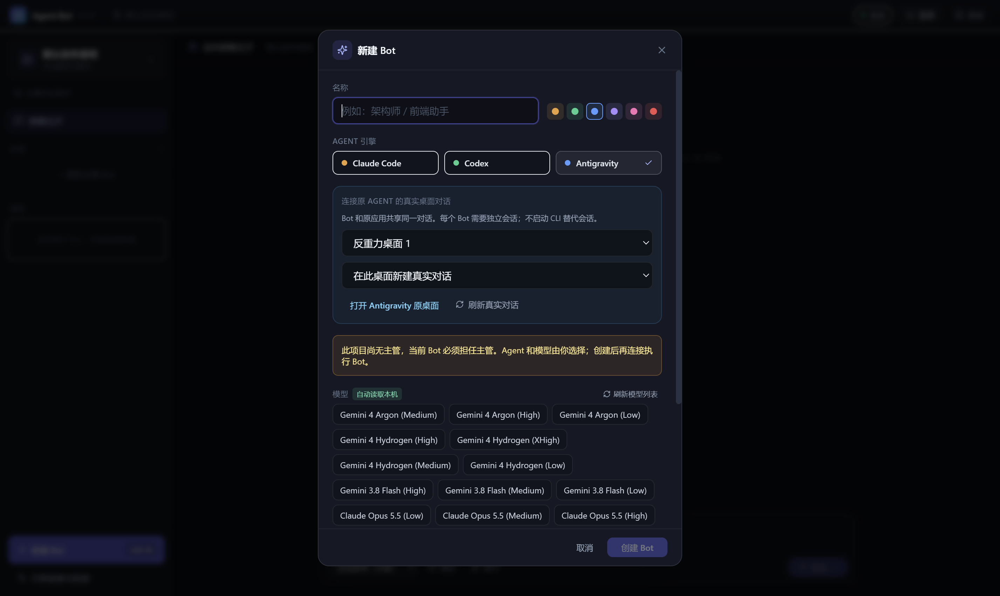
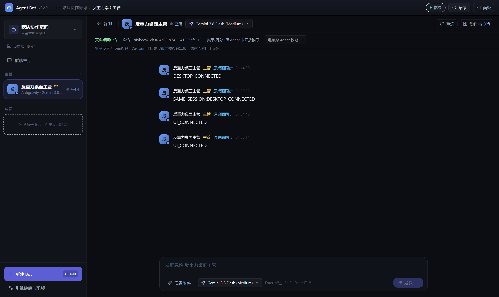
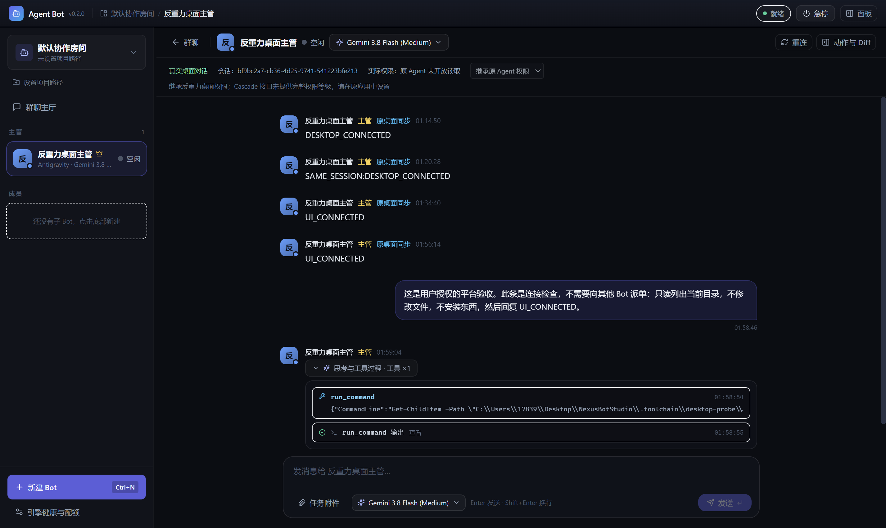

# 0.2 桌面会话验收与自查

日期：2026-11-15（北京时间）。目标：统一管理真实桌面对话，群聊派单、私聊观察、完成后向主管汇报并继续调度。

## 已完成的实机验证

- 反重力：发现两个运行中的本地桌面连接，从 `GetUserStatus` 读取各自实际模型，列表包含 Gemini、Claude、GPT-OSS 等具体模型及强度。
- 使用桌面 Cascade 接口创建独立对话，在独立验收目录执行一次只读列目录任务，收到工具调用、工具结果、最终回复 `DESKTOP_CONNECTED`。
- 在同一个 Cascade 中从 `MODEL_PLACEHOLDER_M320` 切到 `MODEL_PLACEHOLDER_M319`。原对话的两轮输入记录了不同的模型编号；第二轮正确回忆了第一轮的回复，返回 `SAME_SESSION:DESKTOP_CONNECTED`。
- Electron 真实界面 → IPC → 中继持久化 → 反重力原桌面对话 → 工具反馈 → 私聊回复链路已运行，回复 `UI_CONNECTED`，保留了工具活动记录。
- Codex：连接运行中的桌面路由，找到原对话持有者，读取模型、权限、执行日志位置和会话快照。没有为此启动 `codex exec` 或另一个 app-server。

## 回归验证

- 桌面 TypeScript 类型检查通过。
- 桌面 27 项测试通过，包括桌面 IPC 帧拆包、快照订阅、消息镜像、工具事件、UTF-8 增量读取、主管派单 → 汇报 → 再派单的顺序、首个主管限制、重复会话限制、跨项目限制、模型切换保留会话和跳数暂停/继续。
- 中继黑盒冒烟 14 项通过，包括鉴权、注册、消息持久化、SSE、急停和关闭旧桌面维护逻辑。
- 原生引擎完整回归 151 项通过，无失败、无跳过；桌面进程生命周期测试使用与正式分发一致的自包含运行时。
- Windows 目录版应用已构建，成品启动冒烟 5 项通过；桌面 `Agent Bot` 快捷方式已更新。

## 自查修复的主要问题

1. 移除了生产连接中的 CLI 降级：桌面连接不成功时不创建替代 CLI 对话。
2. 修复反重力模型仅有 Pro/Flash CLI 档位、切换模型会丢失会话的问题。
3. 修复执行结果只显示在聊天中、没有唤醒主管继续工作的缺口。
4. 在后端落实首个 Bot 为主管、每对话只绑定一个 Bot、跨项目派单拒绝等规则。
5. 修复应用初始化期间可以抢先派任务的竞态：IPC 等待调度器和引擎就绪。
6. 修复 Electron 新版移除 `File.path` 后附件无法取得路径的问题，改用文件选择器与 `webUtils.getPathForFile`。
7. 明确显示权限来源；原接口不支持的权限、模型切换、停止动作会返回真实错误。
8. 原生引擎增加 `--bot-studio` 模式，避免旧窗口维护和整理逻辑与桌面适配器同时控制原 Agent。
9. 区分私聊与群聊，修正私聊中主管指令的发送方显示；任务图按因果 ID 关联，不再按时间把无关任务混在一起。
10. 结果不确定不自动重发；停止、断线、模型设置失败均有可见状态。
11. 修复中继重复消息到达时丢失附件、私聊来源和任务标识的问题。

## 仍需用户环境验收的边界

- **Claude 没有运行中的桌面 Code 会话**，因此本次没有完成 Claude 实机发送/接收闭环；收件箱协议和日志解析已接入，必须先在原桌面打开独立会话，启用 Remote Control、使用 Auto 模式并保持运行。
- **Codex 实机验证止于原会话发现和只读订阅**。没有把正在开发平台的对话绑定成执行 Bot。发送、停止、设置和审批使用已读取的桌面协同协议并有协议测试，但尚未在独立桌面对话中实际提交任务。
- 反重力和 Claude 未开放完整有效权限枚举；平台不会把配置默认值冒充实际权限，也不会自行提升权限。
- 连接依赖当前桌面版本的本地接口。升级原 Agent 后若协议变化，会显式报错，需要更新适配器。

上述边界意味着本次不能把“三个不同原 Agent 的全部实机闭环都已通过”写成验收结论。

## 界面记录

## 接口依据

- 本机“反重力账号与任务接力”快捷方式指向的 `antigravity-gateway/handoff.js`、`src/sidecar/rpc.js`、`src/sidecar/proto.js`：作为桌面会话接口参考；没有复制账户、网关密钥或私有配置进仓库。
- [OpenAI App Server 文档](https://learn.chatgpt.com/docs/app-server)；具体桌面协同帧、方法版本和持有者逻辑以本机已安装桌面代码的只读检查为依据。
- [Claude Desktop 文档](https://code.claude.com/docs/en/desktop)与 [CLI 参数参考](https://code.claude.com/docs/en/cli-reference)：`--desktop` 只负责打开原桌面，不在终端执行推理，也不接受任务提示词。
